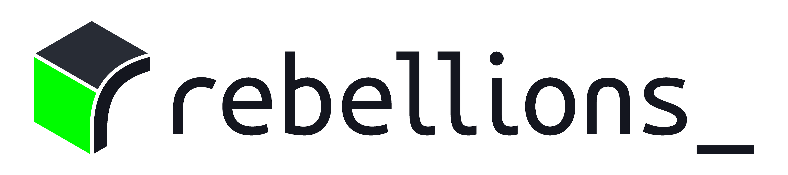

# SGLang RBLN

<div align="center">

<picture>
  <source srcset="assets/rebellions_logo_dark.png" media="(prefers-color-scheme: dark)">
  <source srcset="assets/rebellions_logo_light.png" media="(prefers-color-scheme: light)">
  
</picture>

[](LICENSE)
[](https://docs.rbln.ai/)
[](CODE_OF_CONDUCT.md)

</div>

`sglang-rbln` runs [SGLang Diffusion](https://github.com/sgl-project/sglang/tree/main/python/sglang/multimodal_gen)
on RBLN NPUs. It is an out-of-tree platform plugin: SGLang's own pipelines are
used unchanged, and the DiT blocks are compiled with
[rebel-compiler](https://docs.rbln.ai/) through `torch.compile`.

## Install

```bash
uv pip install --index-strategy unsafe-best-match \
  --extra-index-url https://download.pytorch.org/whl/cpu \
  --extra-index-url https://pypi.rbln.ai/simple \
  sglang-rbln
```

Requires Python 3.11–3.14, an RBLN NPU with its driver, and an account on the
[RBLN package index](https://docs.rbln.ai/latest/getting_started/installation_guide.html).
The plugin activates itself when an NPU is present; set
`SGLANG_DIFFUSION_PLATFORM_OVERRIDE=rbln` when several platform plugins are
installed.

## Quick start

### LTX-2.5

```bash
sglang serve \
  --model-path Lightricks/LTX-2.5-Diffusers \
  --pipeline-class-name LTX2Pipeline
```

```python
from openai import OpenAI

client = OpenAI(api_key="EMPTY", base_url="http://localhost:30000/v1")
video = client.videos.create(
    model="Lightricks/LTX-2.5-Diffusers",
    prompt="A red fox walking through a snowy forest at dawn.",
)
```

### Cosmos3

```bash
sglang serve --model-path nvidia/Cosmos3-Edge
```

```bash
curl -sS -X POST http://localhost:30000/v1/images/generations \
  -H 'Content-Type: application/json' \
  -d '{"prompt": "A small warehouse robot moves a blue box across a clean floor.",
       "size": "640x640", "num_inference_steps": 20, "guidance_scale": 4.0}'
```

Cosmos3 guardrails need `cosmos-guardrail`; `SGLANG_DISABLE_COSMOS3_GUARDRAILS=1`
turns them off. The [SGLang Diffusion cookbook](https://docs.sglang.io/cookbook/diffusion/)
covers the full request options for both models.

## Configuration

| Variable | Effect |
|---|---|
| `SGLANG_RBLN_EXECUTION_MODE` | `auto` (default), `host`, or `device`: where activations live between compiled graphs |
| `SGLANG_RBLN_CACHE_DIR` | compiled-graph cache (default `~/.cache/sglang_rbln`) |
| `SGLANG_RBLN_DISABLE_COMPILE_CACHE=1` | compile without the cache |
| `SGLANG_RBLN_COMPILE_ONLY=1` | compile the graphs and stop before running them |
| `SGLANG_RBLN_COMPILE_STRICT=1` | fail a request whose graph cannot be compiled instead of running it on the host |
| `SGLANG_RBLN_LOG_GRAPHS=1` | log every graph handed to the compiler |

`--enable-torch-compile` and `--regional-compile` are on by default; pass either
flag explicitly to change it.

## Supported models

| Model | Pipeline | Endpoint |
|---|---|---|
| `Lightricks/LTX-2.5-Diffusers` | `LTX2Pipeline` | `/v1/videos` |
| `nvidia/Cosmos3-Edge`, `nvidia/Cosmos3-Super` | `Cosmos3Pipeline` | `/v1/images/generations`, `/v1/videos` |

## Contributing

See [CONTRIBUTING.md](CONTRIBUTING.md). Upstream workarounds are tracked by
`tests/test_hook_inventory.py` and `tests/test_compiler_inventory.py`, which
fail once the upstream change lands.

## License

[Apache License 2.0](LICENSE)
